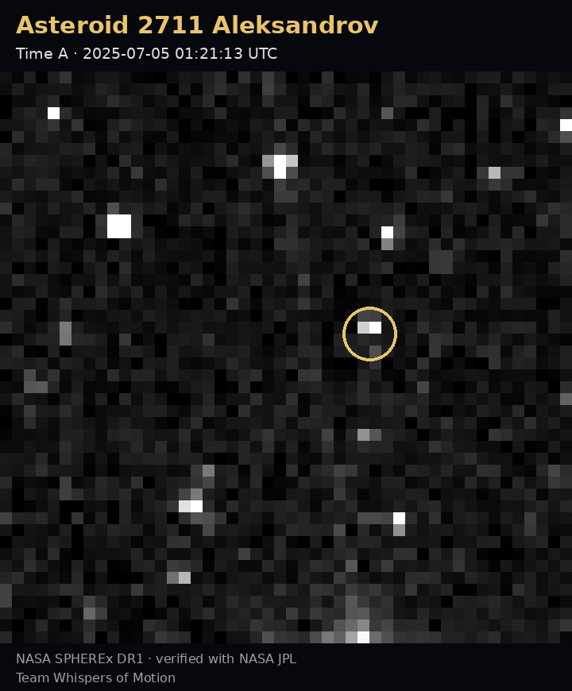
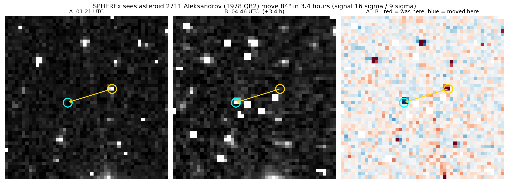
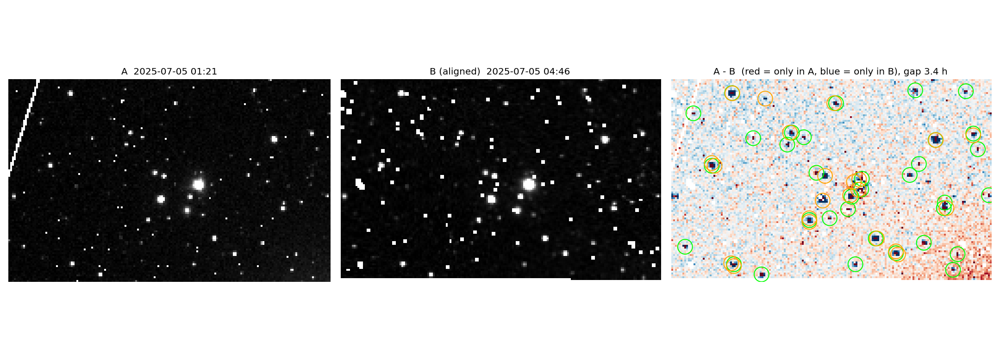
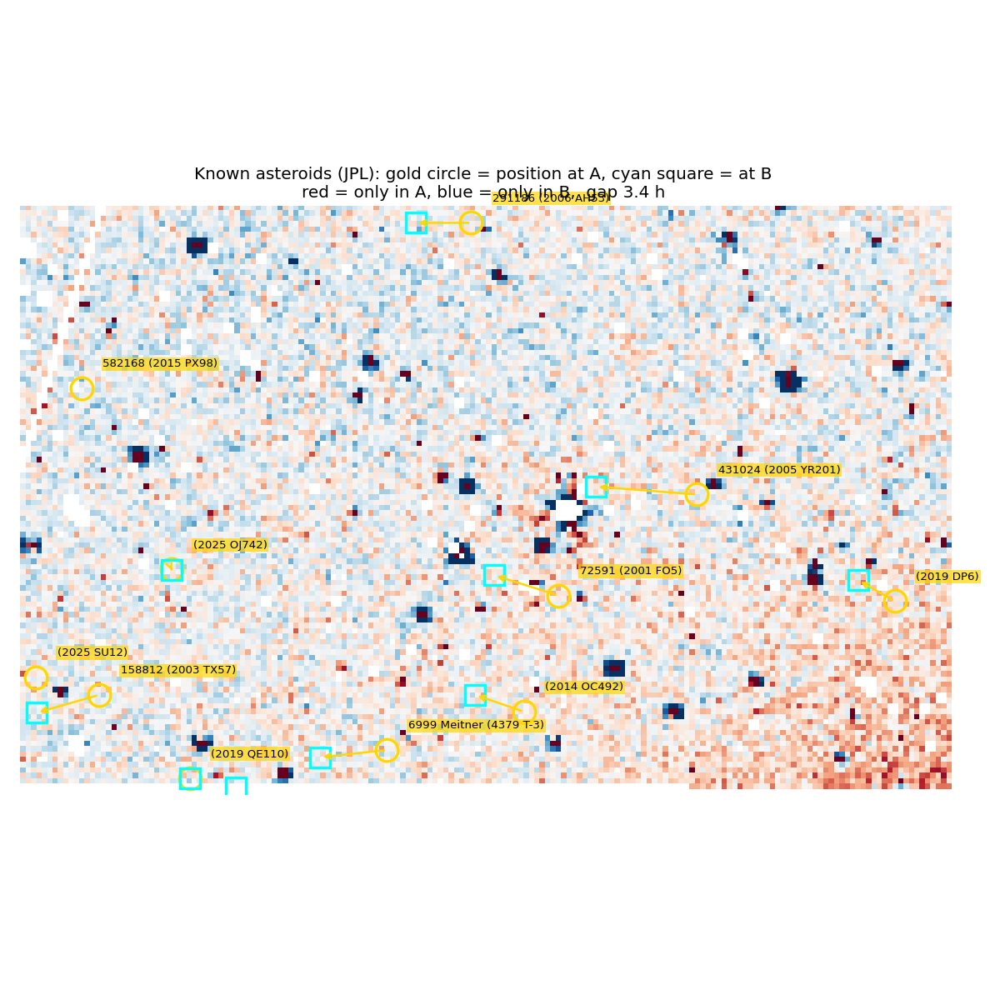
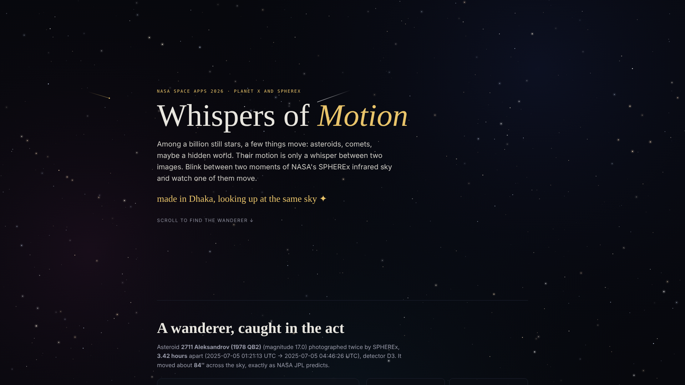

# Whispers of Motion

**Watching the infrared sky move with NASA SPHEREx**

*NASA Space Apps Challenge 2026 · Challenge: Planet X and SPHEREx · Local event: Dhaka, Bangladesh*



**Live website:** `https://YOUR-USERNAME.github.io/whispers-of-motion/`

**Demo video:** `YOUR-YOUTUBE-LINK`

---

## The idea in one paragraph

Planets were once called "wanderers": lights that moved among the fixed stars. NASA's SPHEREx telescope now photographs the whole sky in infrared, capturing more than a billion stars. Hidden among them, a few things are still moving: asteroids, comets, maybe an unknown world. Their motion is tiny, only a few pixels between two images. **Whispers of Motion** makes that motion visible. We take two SPHEREx images of the same patch of sky, taken a few hours apart, line them up, and subtract one from the other. The still stars disappear. Anything that moved leaves a red and blue pair: **red where it was, blue where it went.**

## Our result

We recovered the known asteroid **2711 Aleksandrov (1978 QB2)** in SPHEREx Data Release 1 images taken on 5 July 2025, 3.42 hours apart.

| Measurement | Value |
|---|---|
| Signal at time A | **15.8 sigma** (5 sigma or more is a clear detection) |
| Signal at time B | **9.3 sigma** |
| Motion predicted by NASA JPL | 14.4 pixels |
| Motion we measured | **13.6 pixels** (about 84 arcseconds) |
| Offset agreement between the two positions | 0.9 pixel |

Both detections are shifted from JPL's prediction by the same small amount, which is the signature of one real object moving across the sky. The small shift is expected, because we used Earth's centre as the observer instead of SPHEREx's exact position in orbit.



## How it works

1. **Find the images.** Ask the NASA/IPAC Infrared Science Archive (IRSA) for every SPHEREx image that covers a point in the sky (collection `spherex_dr1`). Our test point, RA 0°, Dec 0°, lies on the ecliptic, where most asteroids travel; 223 images cover it.
2. **Pick two moments.** Choose two exposures from the same detector a few hours apart: long enough for an asteroid to move, short enough to keep it in the picture.
3. **Clean.** Subtract the zodiacal-light model that comes with each image, and hide bad pixels (cosmic rays, hot and cold pixels) using the image's quality flags.
4. **Align.** Re-project image B onto image A's pixel grid using the images' sky coordinates (WCS).
5. **Subtract.** Stars cancel out; moving objects remain as red-blue pairs.
6. **Check with NASA JPL.** Ask the JPL Small-Body Identification service which known asteroids should be in the field at each time, and compare predicted and measured positions.





JPL lists 12 known asteroids in the small 0.3° field, all fainter than magnitude 19, below what a single SPHEREx exposure can see (about magnitude 17–18). So we searched the full 3.5° images for brighter known asteroids and zoomed in on the brightest one we could cut out cleanly.

## The website

`index.html` is a single file with everything inside it. Open it in any browser, or visit the live link above. It lets you:

- **Blink** between the two moments and watch the asteroid jump
- See the **difference image** (red = was here, blue = moved here)
- See every **known asteroid** in the field, from NASA JPL
- Read how the method works and its honest limits



## Repository contents

| Path | What it is |
|---|---|
| `index.html` | The public website (self-contained) |
| `pipeline/01_setup_and_search.py` | Settings and helper functions; searches IRSA for SPHEREx images |
| `pipeline/02_difference_image.py` | Picks two exposures, cleans, aligns and subtracts them |
| `pipeline/03_known_asteroids.py` | Asks NASA JPL which known asteroids are in the field |
| `pipeline/04_target_bright_asteroid.py` | Finds a bright known asteroid in the full images and cuts it out |
| `pipeline/05_measure_and_confirm.py` | Measures the detection and compares it with JPL's prediction |
| `pipeline/06_export_for_website.py` | Saves the images and numbers used by the website |
| `images/` | Result images and `results.json` (all numbers shown above) |
| `requirements.txt` | Python packages needed |

## How to run it yourself

The pipeline was written as notebook cells on [Kaggle](https://www.kaggle.com) (internet must be turned on). Run the six files **in order, in the same notebook session**, because each step uses results from the one before.

```bash
pip install -r requirements.txt
```

To look at a different part of the sky, change `RA` and `DEC` in `01_setup_and_search.py`.

## Honest limits

- SPHEREx sees each image at a slightly different infrared wavelength, so stars do not cancel perfectly and leave small leftovers in the difference image.
- A single exposure only reaches about magnitude 17–18, so fainter asteroids need many images stacked together.
- Predicted positions use Earth's centre rather than SPHEREx's exact orbit, which causes a small, consistent offset of a few pixels.
- We do not claim to have found Planet X. It is our motivation, not our result.

## What's next

- Search many more sky fields automatically
- Train a machine-learning model to separate real moving objects from star leftovers and noise
- Flag moving objects that no catalogue knows yet
- Stack many images to reach fainter, more distant objects

## Data and tools

- [NASA SPHEREx Data Release 1](https://irsa.ipac.caltech.edu/Missions/spherex.html), via the NASA/IPAC Infrared Science Archive (IRSA)
- [IRSA SPHEREx Python tutorials](https://caltech-ipac.github.io/irsa-tutorials/)
- [NASA JPL Small-Body Identification API](https://ssd-api.jpl.nasa.gov/doc/sb_ident.html)
- [Astropy](https://www.astropy.org), [Astroquery](https://astroquery.readthedocs.io), [Reproject](https://reproject.readthedocs.io)

**Acknowledgement:** This publication makes use of data products from the Spectro-Photometer for the History of the Universe, Epoch of Reionization and Ices Explorer (SPHEREx), which is a joint project of the Jet Propulsion Laboratory and the California Institute of Technology, and is funded by the National Aeronautics and Space Administration.

## Use of AI

We used Claude (Anthropic) as an assistant to help draft and debug the Python code, build the website, edit the demo video from our own recorded voice and results, and write project text. We ran all code ourselves on Kaggle, checked the results, and chose the challenge, approach and target.

## Team

**Whispers of Motion**, Bangladesh University of Professionals (BUP), Dhaka

- Shanjida Sultana Jemey (team lead)
- Al Mohian

## License

Code: MIT License. SPHEREx data and images belong to NASA/JPL-Caltech/IPAC.
